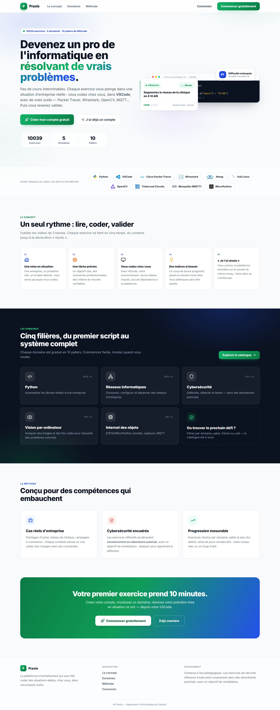
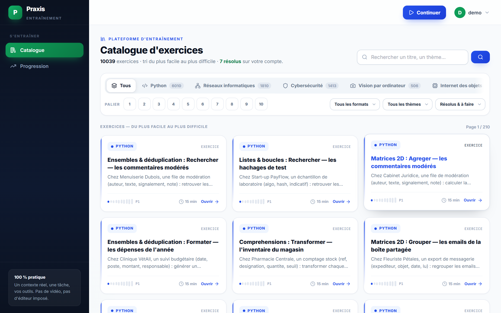
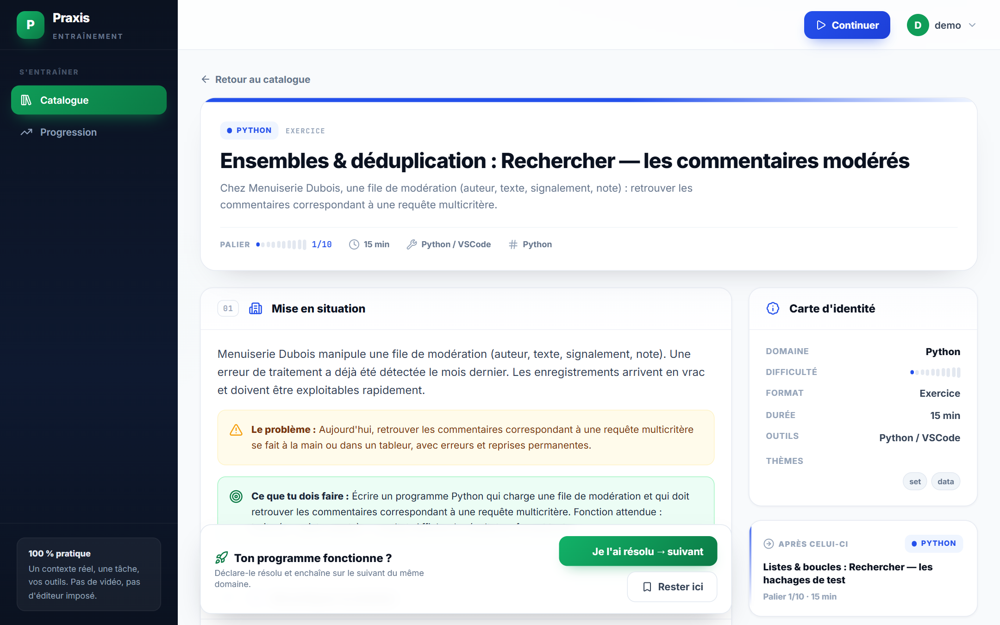
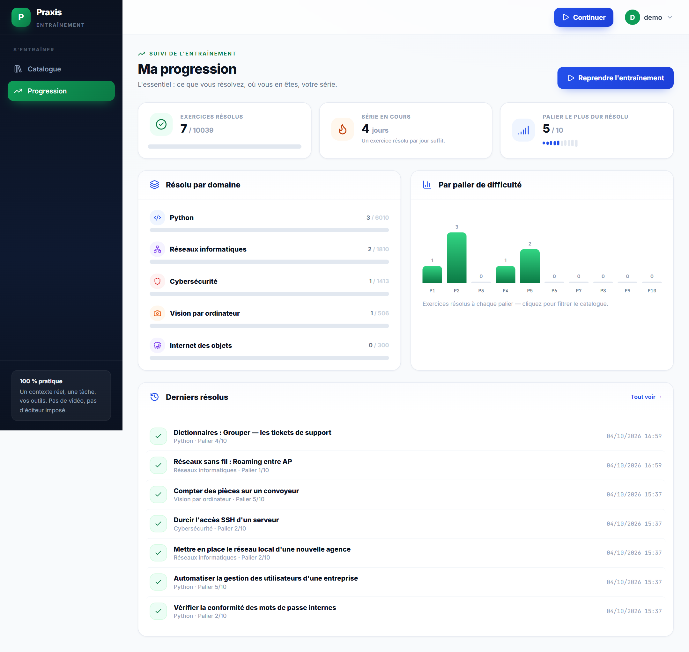

# Praxis — plateforme d'entraînement informatique

**10 039 exercices répartis sur 5 domaines, 10 paliers de difficulté.** Pas de vidéo, pas d'éditeur imposé : un contexte réel, une tâche, des indices progressifs — l'apprenant résout dans ses propres outils (VSCode, Packet Tracer, Kali…), puis déclare l'exercice résolu pour enchaîner sur le suivant.

## Aperçu

| | |
|---|---|
|  | *Page d'accueil — concept, domaines, méthode* |
|  | *Catalogue — filtres domaine / palier / format / thème / état* |
|  | *Fiche exercice — mise en situation, tâche, amorce, indices* |
|  | *Progression — résolus, streak, palier le plus dur* |

## Fonctionnalités

- **Catalogue paginé** (48/page) avec recherche plein texte et filtres combinables : domaine, palier 1→10, format (exercice, atelier, étude de cas…), thème, état (résolu / à faire). Chaque filtre produit une URL partageable.
- **Fiche exercice complète** : mise en situation professionnelle, tâche détaillée, environnement et outils, amorce de code copiable en un clic, critères de validation, **indices progressifs** (dévoilés un par un via HTMX, sans rechargement).
- **Flux « Je l'ai résolu → suivant »** : marquage manuel de résolution, enchaînement automatique dans le même domaine, bouton « Continuer » qui reprend là où l'on s'est arrêté.
- **Progression individuelle** : compteur de résolus, série en cours (streak), palier le plus dur atteint, répartition par domaine et par palier, derniers exercices résolus.
- **Comptes** : inscription/connexion, profil éditable, paramètres de mot de passe ; l'accès à l'espace d'entraînement est protégé, la landing est publique.
- **100 % responsive** (mobile → ultrawide) et **interface en français**.

## Domaines couverts

| Domaine | Exercices | Outils ciblés |
|---|---:|---|
| Python | 6 010 | Python, VSCode |
| Réseaux informatiques | 1 810 | Cisco Packet Tracer, Wireshark |
| Cybersécurité | 1 413 | Nmap, Kali Linux |
| Vision par ordinateur | 506 | OpenCV |
| Internet des objets | 300 | Tinkercad Circuits, Mosquitto (MQTT), MicroPython |

Les exercices sont **générés de façon déterministe** (graine RNG paramétrable) par des générateurs par domaine (`cursus/generators/`), avec variations de contextes, métiers, données et paliers — idempotent, rejouable en CI.

## Stack technique

- **Django 5.2** (monolithe serveur-rendered, pas de SPA) + **SQLite**
- Templates Django + **Tailwind CSS** (CDN, thème personnalisé), **Lucide** (icônes), **HTMX** (indices progressifs)
- Polices Inter / JetBrains Mono
- Aucun autre service externe : pas de node_modules, pas de build step

## Installation

```bash
# 1. Environnement
python -m venv .venv
.venv\Scripts\activate          # Windows  (Linux/macOS : source .venv/bin/activate)
pip install -r requirements.txt

# 2. Base de données
python manage.py migrate

# 3. Peupler le catalogue (~10 000 exercices, quelques secondes)
python manage.py generate_exercices
#   options : --python 6000 --reseaux 1800 --cyber 1400 --vision 500 --iot 300 --graine 42

# 4. (optionnel) Contenu + comptes de démonstration
python manage.py seed_demo

# 5. Lancer
python manage.py runserver
```

Le site est alors visible sur <http://127.0.0.1:8000/>.

> 📱 **Tester sur téléphone** : lancez `python manage.py runserver 0.0.0.0:8000` et ouvrez
> `http://<IP-de-votre-PC>:8000` depuis un appareil du même réseau Wi-Fi.

### Administration Django

Créez votre propre super-utilisateur, puis connectez-vous sur `/admin/` :

```bash
python manage.py createsuperuser
```

L'admin permet de gérer domaines, exercices, étapes, indices, profils et progressions
(`cursus/admin.py` — recherche, filtres et listes personnalisées).

### Structure du projet

```
config/                  # settings, urls, wsgi/asgi
cursus/
  models.py              # Domaine, Mission, Etape, Indice, MissionProgress, Profil…
  views.py               # landing, catalogue+filtres, fiche, résolution, progression, comptes
  generators/            # générateurs d'exercices par domaine (déterministes)
  management/commands/   # generate_exercices, seed_demo
  templatetags/          # filtres template (make_list, liste_csv…)
templates/cursus/        # accueil, catalogue, mission_detail, progression, profil…
static/css/app.css       # design system (cartes, jauges de palier, filtres, landing)
static/icons/            # logos techno SVG (couleurs de marque, auto-hébergés)
```

## Notes

- `db.sqlite3` est fourni pour l'instantanéité de la démo ; en production, régénérez-le
  (`migrate` + `generate_exercices`) et passez `DEBUG = False` avec un vrai `SECRET_KEY`.
- Les logos proviennent de [Devicon](https://devicon.dev), [Simple Icons](https://simpleicons.org)
  et nmap.org, re-colorés aux teintes officielles de marque.
